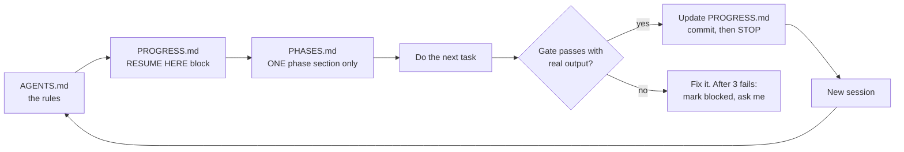
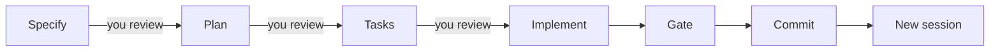

<p align="center">
  
</p>

<p align="center">
  
  
  
  
  
</p>

<p align="center">
  
  
  <a href="https://github.com/MuhammadHamidRaza/agent-phase-kit/stargazers"></a>
</p>

<h3 align="center">Stop restarting your AI coding projects.<br>Four plain files, small phases, and a gate that proves each phase is really done.</h3>

<p align="center">
  ⭐ <b>If this saves you time, <a href="https://github.com/MuhammadHamidRaza/agent-phase-kit">star this repo</a></b> so more developers can find it.
</p>

> 💡 **This is not a framework or a CLI.** It is four Markdown files and two ready-to-paste prompts (one for people **with** Spec Kit, one for people **without** it). Setup takes about ten minutes.

## Topics
ai-agents, claude-code, opencode, codex-cli, gemini-cli, spec-driven-development, spec-kit, agents-md, developer-workflow, prompt-engineering

<details>
<summary><b>📑 Table of contents (click to open)</b></summary>

- [⚡ TL;DR](#tldr)
- [😤 Why this exists: 1.5 years of failing](#why)
- [🧩 The problem and the fix](#problem)
- [⚙️ How it works](#how)
- [🧭 Choose your path: with or without Spec Kit](#paths)
- [🤖 Works with every AI coding tool](#tools)
- [🚀 Quick start](#quick-start)
- [🅰️ Path A: with Spec Kit (prompts)](#path-a)
- [🅱️ Path B: without Spec Kit (prompts)](#path-b)
- [🔁 Sessions: /new, /clear and /compact](#sessions)
- [📏 Keep each spec small](#small)
- [📂 The four files in detail](#files)
- [🛒 Example run: a small e-commerce store](#example)
- [🛠️ Troubleshooting](#troubleshooting)
- [🔒 Safety rules](#safety)
- [❓ FAQ](#faq)
- [🌐 Resources and connect with me](#connect)

</details>

---

<a id="tldr"></a>
## ⚡ TL;DR

| | |
|---|---|
| 🧠 | **Memory lives in files, not in the chat.** The chat is temporary. The repo is permanent. |
| 🧱 | **Work in small phases.** One phase = one spec = one or two sessions. |
| ✅ | **A phase is done only when its gate passes with real command output.** "The agent said it works" does not count. |
| 🔄 | **Start a fresh session for every phase.** One line brings the agent back to exactly where you stopped. |

---

<a id="why"></a>
## 😤 Why this exists: 1.5 years of failing

For about **1.5 years** I used AI coding agents the wrong way. I would write a big plan, open one long chat, and say "build all of it."

- 🟢 For the first few hours it worked.
- 🔴 Then the agent forgot the rules, built the wrong thing, or quietly skipped steps.
- 🔁 I restarted. I rewrote the whole plan **five or six times, maybe more**.
- 😵 Every new chat meant explaining everything again.

The biggest problem was not the agent. It was me treating **the chat as memory**, and treating **"done" as "the agent said so."**

A real example from a project I am building: one phase had **398 passing unit tests**. When I ran the real gate against the real tool, it found a database migration that silently did nothing, and a command flag the tool had removed. The unit tests missed both. Only running the real thing caught them.

**What I do now**

- 📁 Memory is in four files the agent reads at the start of every session.
- 🧱 The plan is split into small phases, each with a gate (exact commands and the output I expect).
- 👀 I review every spec, plan and task list before any code is written.
- 🆕 I start a new session for each phase instead of one endless chat.

This kit is that system, cleaned up so you can copy it.

---

<a id="problem"></a>
## 🧩 The problem and the fix

AI coding agents are fast, but unreliable on any project bigger than one afternoon.

| What goes wrong | Why it happens | What the kit does about it |
|---|---|---|
| 🧠 The agent **forgets** rules and decisions | Long chats fill the context window and early content falls out | Rules and plan live in files that are re-read every session |
| 🏁 The agent says **"done"** too early | Nobody asked for proof | A phase is done only when its gate passes with real output |
| 🌀 The agent **drifts** into new features | A small idea mid-task grows into scope creep | New ideas go to `IDEAS.md`; the current phase stays small |
| 🔁 Every new session **starts from zero** | The chat was the only memory | `PROGRESS.md` has a `RESUME HERE` block a fresh session can follow |
| 💸 **Cost** keeps growing | Long loops burn tokens on unchecked work | Small phases, short sessions, and a stop rule when a gate fails |

---

<a id="how"></a>
## ⚙️ How it works

### The four files

| File | What it is for |
|---|---|
| 📜 `AGENTS.md` | The rulebook every session reads first |
| 🗺️ `PHASES.md` | The plan: small phases, each with tasks and an exact gate |
| 📍 `PROGRESS.md` | The live status, plus a `RESUME HERE` block for any new session |
| 💡 `IDEAS.md` | A parking lot for new ideas, so they never derail the current phase |

### How a brand-new session knows what to do



The agent reads nothing else. That keeps the context small and the work focused.

### The loop for every phase



The agent stops after each step and waits for you. It moves on only when you say so.

---

<a id="paths"></a>
## 🧭 Choose your path: with or without Spec Kit

Both paths produce the **same four files** and use the **same rules**. The only difference is how the spec, plan and tasks get written.

| | 🅰️ **Path A: with Spec Kit** | 🅱️ **Path B: without Spec Kit** |
|---|---|---|
| **Best for** | You already have [GitHub Spec Kit](https://github.com/github/spec-kit) (or a variant) installed | Any folder, any tool, nothing extra to install |
| **Spec, plan, tasks** | Written by the Spec Kit commands | Written by the agent as plain files in `specs/phase-N/` |
| **Review stops** | After every step | After every step (same) |
| **Prompts** | A1 Bootstrap + A2 Phase | B1 Bootstrap + B2 Phase |
| **Jump to** | [Path A prompts](#path-a) | [Path B prompts](#path-b) |

> The two sets of prompts are kept **separate on purpose**. Pick one path and stay on it for the whole project.

---

<a id="tools"></a>
## 🤖 Works with every AI coding tool

Each tool reads a different instruction file. The rule is the same: **keep one real file, `AGENTS.md`, and add tiny bridge files that point to it.**

| Tool | Reads by default | What to do |
|---|---|---|
| 🟦 OpenCode | `AGENTS.md` | Nothing extra |
| 🟩 Codex CLI | `AGENTS.md` | Nothing extra |
| ⬛ Cursor | `AGENTS.md` | Nothing extra (confirm in your version) |
| 🟧 Claude Code | `CLAUDE.md` | Create `CLAUDE.md` containing one line: `@AGENTS.md` |
| 🔷 Gemini CLI | `GEMINI.md` | Create `GEMINI.md` containing one line: `@./AGENTS.md`, or set `context.fileName` in its settings to include `AGENTS.md` |
| ⚪ Windsurf, Copilot, Aider and others | Mostly `AGENTS.md` | Check the tool's docs |

Do not rename `AGENTS.md` to `CLAUDE.md` or `GEMINI.md`. Other tools would stop seeing it.

> ⚠️ Tool behaviour and file names change between versions. Check each tool's current documentation before relying on a bridge file.

---

<a id="quick-start"></a>
## 🚀 Quick start

**You need**

- Git, and the runtime for your project (for example Node.js)
- One AI coding tool from the table above
- **Path A only:** Spec Kit set up in the project folder (a `.specify/` folder should exist)

**Steps**

1. 📁 Create an empty folder and open it in your AI tool.
2. 🧭 Choose **Path A** or **Path B** (see above).
3. 🆕 Open a **new session** and paste that path's **Bootstrap prompt**. Fill in the `MY PROJECT:` line.
4. 💬 Answer the interview questions. The agent keeps asking until nothing important is unclear.
5. 🔢 The agent suggests a few phase counts. You choose.
6. ✍️ When the summary is right, reply **`WRITE FILES`**. The four files are created.
7. ▶️ Reply **`yes`** to start Phase 1.

For every phase after that, open a **new session** and send:

```text
Read AGENTS.md and PROGRESS.md, continue at RESUME HERE.
```

Then paste that path's **Phase prompt**.

---

<a id="path-a"></a>
## 🅰️ Path A: with Spec Kit

Use these two prompts if Spec Kit is installed (a `.specify/` folder exists). Command names depend on your Spec Kit variant. These prompts use `/sp.specify`, `/sp.plan`, `/sp.tasks` and `/sp.implement`. If your install uses different names (for example `/speckit.specify`), use those.

**Why Spec Kit helps.** Each step is a checkpoint where you can catch a mistake while it is still cheap to fix.

| Step | What you check | What breaks if you skip it |
|---|---|---|
| **Specify** | Is the goal clear? Is it small enough for one phase? | Vague goals; the agent invents features |
| **Plan** | Are the approach, files and risks right? | A wrong design found too late |
| **Tasks** | Are the steps small and testable? | Tasks too big to finish or verify |
| **Implement** | Does each task show real output? | "Done" with no proof |

<details>
<summary><b>🅰️ Prompt A1: Bootstrap (use once per project)</b></summary>

```text
You are my build partner. We will set up a professional phase-by-phase, spec-driven project. Do NOT write app code. Do NOT create any file until I reply WRITE FILES.

MY PROJECT: [DESCRIBE YOUR PROJECT HERE: what it does, the stack, and what is off-limits. Mention my operating system and shell so commands match, for example Windows PowerShell, macOS zsh, or Linux bash.]

SPEC KIT: this folder should already have Spec Kit (the /sp.specify, /sp.plan, /sp.tasks and /sp.implement commands, or your variant's equivalents). Check that the .specify folder exists. If it does not, tell me and STOP.

STAGE 1 - CLARITY INTERVIEW (no files yet).
Keep asking until nothing important is unclear. There is NO fixed number of questions: ask while a required item is still unknown, and stop as soon as all are known (it could be 3 questions or 30).
Checklist of items that must be settled: users and goal; accounts or no accounts; how any admin area is protected; each feature area; data and seed data; design and styling; testing (what automated checks prove each part, and which tools I would need to approve); folder layout; off-limits; what "done" means for the whole project.
Rules: ask one short round at a time and bundle related questions; number them; give 2 or 3 options plus your recommended default so I can answer fast (for example: 1B, 2 default); never ask what I already said; never ask the same thing twice; if I say "no preference", pick a sensible default and say so; if I say "plan now", stop asking and use defaults for what is unknown.
After each round, show which checklist items are settled and which are still unknown. When every item is settled, show a short summary of the whole project and ask: "Is this correct? Anything missing?" Wait for my answer.

STAGE 2 - SUGGEST THE PHASE COUNT.
Do not decide it alone. Based on the real size of the project, give me 3 options, each with its number of phases, one line per phase, and the trade-off: (a) fewer, bigger phases; (b) your recommended split; (c) more, smaller phases.
Rules for any split: one theme per phase; at most 5 tasks per phase; each phase has a gate I can run in minutes with exact commands; no phase needs more than one or two sessions. Warn me honestly if I ask for too few phases (a phase is too big to verify) or too many (too much setup overhead). If I ask for a number you think is wrong, say why once, then follow my choice. Ask: "Which option, or give me a number?" and wait. Then show the final phase list (titles and one-line goals) and ask me to confirm. Do NOT create any file until I reply WRITE FILES.

STAGE 3 - WRITE THE FILES (only after I reply WRITE FILES). Each file must be detailed, not a short outline.

FILE 1: AGENTS.md
- A title and one paragraph: what the project is and the stack.
- "Non-negotiables", numbered: (1) Current phase only: read PROGRESS.md, then only the current phase section of PHASES.md. (2) Rule of 3: if a gate fails in 3 fresh sessions, STOP, mark the phase blocked in PROGRESS.md, write options in IDEAS.md, and ask me; never add complexity to force a gate green. (3) A gate passes only with pasted real command output. (4) Smallest possible change: no extra features, refactors or files beyond the current task. (5) New ideas go to IDEAS.md as one row, never into the current phase. (6) No secrets in files, chat or git; environment variables only. (7) Ask before installing any dependency. (8) Use commands that work on my operating system and shell.
- "Session protocol (every session, in order)": 1 Read PROGRESS.md and find the RESUME HERE block. 2 Read ONLY the PHASES.md section it names. 3 Do only the next task. 4 Run the gate commands and paste real output. 5 Gate green: mark the phase done, add a session log row, REWRITE the RESUME HERE block for the next session, commit, then STOP. 6 Gate red: fix it or mark blocked. Never mark done without evidence.
- "Fresh session first message", exactly: Read AGENTS.md and PROGRESS.md, continue at RESUME HERE.
- "Spec Kit flow": one phase = one Spec Kit feature. Order: specify (input: that phase's Build list from PHASES.md), STOP for my review, plan, STOP, tasks, STOP, then implement one task at a time, then run the phase Gate. Never hand-write spec files outside Spec Kit's own folders. Each new phase starts in a NEW session with a new specify step. Record one prompt-history entry per completed task, never per message.
- "Commands": the real install, dev, build, test and lint commands for this stack.
- "Hard rules": the stack list, folder layout, naming, database changes only through seed or migration scripts, automated checks in a tests or scripts folder.
- "Formats": one example line each for a commit message, a PROGRESS row, a blocker row and an IDEAS row.

FILE 2: PHASES.md
- Top: how this plan works (one phase at a time; a gate is exact commands plus expected output; Rule of 3; ideas go to IDEAS.md).
- A progress tracker with a checkbox for every phase.
- A "Decisions" table (D1, D2, ...) with the choices settled in the interview.
- The phases I confirmed. Each has ONE theme and at most 5 tasks, and has: Goal; Build (numbered tasks, written so I can paste the list straight into the specify command); Not yet; Gate. The Gate is exact commands with the exact output I should see (build exits 0, tests pass with a count, a request returns an expected status or text). No gate may be manual-only: where a browser is needed, also add an automated test or script.
- A closing Coverage list showing which phase delivers each feature I asked for.

FILE 3: PROGRESS.md
- Header: last updated date, current phase, status key ([ ] not started, [~] in progress, [x] done with gate evidence, [!] blocked).
- A block titled *** RESUME HERE *** with: Phase and its name; Next task (for a new phase: run the specify command with that phase's Build list); Read only (the exact PHASES.md section); Gate command to run; Notes for the next session. Write it so a brand-new session with zero memory can continue from this block alone.
- A phase status table with a Notes column; a Blockers table (date, phase, blocker, options); a Session log table (date, phase, what was done, gate result).

FILE 4: IDEAS.md
- A protocol paragraph: append a row the moment an idea appears, never act on it mid-phase, triage only between phases (promote, defer or delete).
- A table: Date, Idea, Why it matters, Suggested phase.

If you are Claude Code, also create CLAUDE.md containing only the line: @AGENTS.md
If you are Gemini CLI, also create GEMINI.md containing only the line: @./AGENTS.md

STAGE 4 - When the files are done: explain in simple words, in the language I write in, why each file exists (2 lines each), and how a NEW session knows what to read (AGENTS.md points to PROGRESS.md, whose RESUME HERE block points to one section of PHASES.md). Then ask exactly: "Start Phase 1? Reply yes." and STOP. Never do all phases at once.
```

</details>

<details>
<summary><b>🅰️ Prompt A2: Phase (use for every phase, in a new session)</b></summary>

Send this first:

```text
Read AGENTS.md and PROGRESS.md, continue at RESUME HERE.
```

Then, if the agent does not start by itself:

```text
We are on the phase named in RESUME HERE, and only that phase. Use Spec Kit. Do this in order and STOP at each STOP:
1. SPECIFY: run /sp.specify using that phase's Build list from PHASES.md as the description. Keep it small. STOP for my review.
2. PLAN: run /sp.plan (approach, files, risks). STOP for my review.
3. TASKS: run /sp.tasks (small ordered tasks, each with a check). STOP for my review.
4. IMPLEMENT: run /sp.implement one task at a time. After each task run its check and show the real output.
5. GATE: run the phase Gate from PHASES.md and paste the real output. Only if it passes: mark the phase done in PROGRESS.md, add a session log row, REWRITE the RESUME HERE block for the next phase, and commit. Then STOP.
Never hand-write spec files outside Spec Kit's own folders. Any new idea goes to IDEAS.md as one row. If the gate fails 3 times, stop and tell me.
```

</details>

---

<a id="path-b"></a>
## 🅱️ Path B: without Spec Kit

Use these two prompts if you do **not** have Spec Kit. Nothing extra to install. The agent writes the spec, plan and tasks as plain Markdown files in `specs/phase-N/`, and still stops for your review after each one.

| Step | File the agent writes | What you check |
|---|---|---|
| **Spec** | `specs/phase-N/spec.md` | What and why, out of scope, acceptance checks |
| **Plan** | `specs/phase-N/plan.md` | Approach, files to touch, risks |
| **Tasks** | `specs/phase-N/tasks.md` | Small ordered tasks, each with a check |
| **Implement** | The project's real files | Real output after every task |

<details>
<summary><b>🅱️ Prompt B1: Bootstrap (use once per project)</b></summary>

```text
You are my build partner. We will set up a professional phase-by-phase project WITHOUT Spec Kit. Do NOT write app code. Do NOT create any file until I reply WRITE FILES.

MY PROJECT: [DESCRIBE YOUR PROJECT HERE: what it does, the stack, and what is off-limits. Mention my operating system and shell so commands match, for example Windows PowerShell, macOS zsh, or Linux bash.]

STAGE 1 - CLARITY INTERVIEW (no files yet).
Keep asking until nothing important is unclear. There is NO fixed number of questions: ask while a required item is still unknown, and stop as soon as all are known (it could be 3 questions or 30).
Checklist of items that must be settled: users and goal; accounts or no accounts; how any admin area is protected; each feature area; data and seed data; design and styling; testing (what automated checks prove each part, and which tools I would need to approve); folder layout; off-limits; what "done" means for the whole project.
Rules: ask one short round at a time and bundle related questions; number them; give 2 or 3 options plus your recommended default so I can answer fast (for example: 1B, 2 default); never ask what I already said; never ask the same thing twice; if I say "no preference", pick a sensible default and say so; if I say "plan now", stop asking and use defaults for what is unknown.
After each round, show which checklist items are settled and which are still unknown. When every item is settled, show a short summary of the whole project and ask: "Is this correct? Anything missing?" Wait for my answer.

STAGE 2 - SUGGEST THE PHASE COUNT.
Do not decide it alone. Based on the real size of the project, give me 3 options, each with its number of phases, one line per phase, and the trade-off: (a) fewer, bigger phases; (b) your recommended split; (c) more, smaller phases.
Rules for any split: one theme per phase; at most 5 tasks per phase; each phase has a gate I can run in minutes with exact commands; no phase needs more than one or two sessions. Warn me honestly if I ask for too few phases (a phase is too big to verify) or too many (too much setup overhead). If I ask for a number you think is wrong, say why once, then follow my choice. Ask: "Which option, or give me a number?" and wait. Then show the final phase list (titles and one-line goals) and ask me to confirm. Do NOT create any file until I reply WRITE FILES.

STAGE 3 - WRITE THE FILES (only after I reply WRITE FILES). Each file must be detailed, not a short outline.

FILE 1: AGENTS.md
- A title and one paragraph: what the project is and the stack.
- "Non-negotiables", numbered: (1) Current phase only: read PROGRESS.md, then only the current phase section of PHASES.md. (2) Rule of 3: if a gate fails in 3 fresh sessions, STOP, mark the phase blocked in PROGRESS.md, write options in IDEAS.md, and ask me; never add complexity to force a gate green. (3) A gate passes only with pasted real command output. (4) Smallest possible change: no extra features, refactors or files beyond the current task. (5) New ideas go to IDEAS.md as one row, never into the current phase. (6) No secrets in files, chat or git; environment variables only. (7) Ask before installing any dependency. (8) Use commands that work on my operating system and shell.
- "Session protocol (every session, in order)": 1 Read PROGRESS.md and find the RESUME HERE block. 2 Read ONLY the PHASES.md section it names. 3 Do only the next task. 4 Run the gate commands and paste real output. 5 Gate green: mark the phase done, add a session log row, REWRITE the RESUME HERE block for the next session, commit, then STOP. 6 Gate red: fix it or mark blocked. Never mark done without evidence.
- "Fresh session first message", exactly: Read AGENTS.md and PROGRESS.md, continue at RESUME HERE.
- "Spec flow (no Spec Kit)": for each phase, create the folder specs/phase-N/ and write three files ONE AT A TIME, stopping for my review after each: spec.md (what and why, user-visible behavior, out of scope, acceptance checks), plan.md (approach, files to touch, risks), tasks.md (small ordered tasks, each with a check). Only after I approve all three: implement one task at a time, then run the phase Gate. Keep each spec small enough for one or two sessions. Each new phase starts in a NEW session.
- "Commands": the real install, dev, build, test and lint commands for this stack.
- "Hard rules": the stack list, folder layout, naming, database changes only through seed or migration scripts, automated checks in a tests or scripts folder.
- "Formats": one example line each for a commit message, a PROGRESS row, a blocker row and an IDEAS row.

FILE 2: PHASES.md
- Top: how this plan works (one phase at a time; a gate is exact commands plus expected output; Rule of 3; ideas go to IDEAS.md).
- A progress tracker with a checkbox for every phase.
- A "Decisions" table (D1, D2, ...) with the choices settled in the interview.
- The phases I confirmed. Each has ONE theme and at most 5 tasks, and has: Goal; Build (numbered tasks, written so I can paste the list straight into a spec request); Not yet; Gate. The Gate is exact commands with the exact output I should see (build exits 0, tests pass with a count, a request returns an expected status or text). No gate may be manual-only: where a browser is needed, also add an automated test or script.
- A closing Coverage list showing which phase delivers each feature I asked for.

FILE 3: PROGRESS.md
- Header: last updated date, current phase, status key ([ ] not started, [~] in progress, [x] done with gate evidence, [!] blocked).
- A block titled *** RESUME HERE *** with: Phase and its name; Next task (for a new phase: write specs/phase-N/spec.md from that phase's Build list); Read only (the exact PHASES.md section); Gate command to run; Notes for the next session. Write it so a brand-new session with zero memory can continue from this block alone.
- A phase status table with a Notes column; a Blockers table (date, phase, blocker, options); a Session log table (date, phase, what was done, gate result).

FILE 4: IDEAS.md
- A protocol paragraph: append a row the moment an idea appears, never act on it mid-phase, triage only between phases (promote, defer or delete).
- A table: Date, Idea, Why it matters, Suggested phase.

If you are Claude Code, also create CLAUDE.md containing only the line: @AGENTS.md
If you are Gemini CLI, also create GEMINI.md containing only the line: @./AGENTS.md

STAGE 4 - When the files are done: explain in simple words, in the language I write in, why each file exists (2 lines each), and how a NEW session knows what to read (AGENTS.md points to PROGRESS.md, whose RESUME HERE block points to one section of PHASES.md). Then ask exactly: "Start Phase 1? Reply yes." and STOP. Never do all phases at once.
```

</details>

<details>
<summary><b>🅱️ Prompt B2: Phase (use for every phase, in a new session)</b></summary>

Send this first:

```text
Read AGENTS.md and PROGRESS.md, continue at RESUME HERE.
```

Then, if the agent does not start by itself:

```text
We are on the phase named in RESUME HERE, and only that phase. Do this in order and STOP at each STOP:
1. SPEC: create specs/phase-N/spec.md from that phase's Build list in PHASES.md (what and why, user-visible behavior, out of scope, acceptance checks). Keep it small. STOP for my review.
2. PLAN: write specs/phase-N/plan.md (approach, files to touch, risks). STOP for my review.
3. TASKS: write specs/phase-N/tasks.md (small ordered tasks, each with a check). STOP for my review.
4. IMPLEMENT: one task at a time. After each task run its check and show the real output.
5. GATE: run the phase Gate from PHASES.md and paste the real output. Only if it passes: mark the phase done in PROGRESS.md, add a session log row, REWRITE the RESUME HERE block for the next phase, and commit. Then STOP.
Any new idea goes to IDEAS.md as one row. If the gate fails 3 times, stop and tell me.
```

</details>

---

<a id="sessions"></a>
## 🔁 Sessions: /new, /clear and /compact

**Keep one spec per session.** A session does one phase, then ends. The files hold the memory, so ending a session loses nothing.

| Situation | What to do |
|---|---|
| ✅ A phase or task is finished and committed | Start a **fresh session** (`/clear` in Claude Code, `/new` in OpenCode) |
| 🗑️ The chat is full of failed attempts or wrong turns | Fresh session. Do not compact a mess |
| 🗜️ Mid-task and the context is about 60 to 70 percent full | `/compact` with an instruction, for example: `keep the current task, decisions made, changed files, open bugs and the next step` |
| 🤔 Unsure after a compact | Ask: "What are we doing, and what is the next step?" If the answer is wrong, start a fresh session from the files |
| ☕ Coming back after a break | Fresh session, then: `Read AGENTS.md and PROGRESS.md, continue at RESUME HERE.` |

> 🧠 **Quick rule:** task finished means **clear**. Task still in progress means **compact**.

Before you clear, check three things:

1. ✅ The work is committed.
2. ✅ `PROGRESS.md` and the `RESUME HERE` block are up to date.
3. ✅ Any new idea is written in `IDEAS.md`.

Notes:

- Command names differ by tool. Other tools have their own "new session" and "compact" commands.
- Whether `/compact` accepts instruction text depends on the tool. Test it once. If it ignores your text, put a short "when compacting, keep..." rule in `AGENTS.md`.
- Most tools can show how full the context is (Claude Code has `/context`). Check it before starting something big.

---

<a id="small"></a>
## 📏 Keep each spec small

A small spec is the single biggest reason this works.

- 🎯 **One theme per phase.** If you need the word "and" to describe it, split it.
- 🔢 **At most 5 tasks per phase.**
- ⏱️ **A gate you can run in minutes**, with exact commands and expected output.
- 📅 **One or two sessions per phase.** If it needs more, split it.
- ⚖️ **Not too small either.** Dozens of tiny phases cost more in setup than they save. For a small app, 4 to 10 phases is usually right.

---

<a id="files"></a>
## 📂 The four files in detail

### 📜 `AGENTS.md`: the rulebook

Read first in every session.

- **Non-negotiables:** one phase at a time, Rule of 3, gates need real output, smallest change, ideas go to `IDEAS.md`, no secrets, ask before installing anything.
- **Session protocol:** read `PROGRESS.md`, read only the named phase, do the next task, run the gate, update `RESUME HERE`, commit, stop.
- **Spec flow:** the Spec Kit steps (Path A) or the three plain files in `specs/phase-N/` (Path B), with a review stop after each.

### 🗺️ `PHASES.md`: the plan

- A progress checklist and a **Decisions** table (D1, D2, ...), so settled choices are never reopened.
- Each phase has one theme, at most 5 tasks, a Goal, a Build list (paste it straight into the specify step), a Not-yet list, and a **Gate**.
- A Coverage list showing which phase delivers which feature.

A gate looks like this:

```text
Gate:
  npm run build       -> exits 0
  npm run typecheck   -> exits 0
  npm run smoke       -> prints "OK /" and "OK /products/1"
```

### 📍 `PROGRESS.md`: the live status

A `RESUME HERE` block that a session with no memory can follow:

```text
*** RESUME HERE ***
Phase:        3 - Seed data
Next task:    Start the spec for Phase 3 from its Build list
Read only:    PHASES.md -> "Phase 3 - Seed data"
Gate command: npm run db:seed ; npm run db:count ; npm run build
Notes:        Fresh session. Ask before installing anything.
```

It also holds a phase status table, a blockers table (with options), and a session log (with gate results).

### 💡 `IDEAS.md`: the parking lot

- Add one row whenever a new idea appears.
- Never act on an idea in the middle of a phase.
- Triage only between phases: promote, defer, or delete.

---

<a id="example"></a>
## 🛒 Example run: a small e-commerce store

The video builds a small store with this kit. Features: a product catalog with search and a category filter, buyer accounts plus guest checkout, a server-side cart, checkout with a **fake** payment toggle (no real keys), and an admin dashboard protected by a password in an environment file.

The interview and phase-count step produced 10 phases:

| # | Phase | One-line goal |
|---|---|---|
| 1 | 🏗️ Scaffold & tooling | A runnable app with scripts and an env template |
| 2 | 🗄️ Database schema & migrations | A database with an idempotent migration runner |
| 3 | 🌱 Seed data | About 12 products, seeded repeatably |
| 4 | 🛍️ Catalog listing & detail | Browse products with a category filter |
| 5 | 🔎 Catalog search | Text search combined with the filter |
| 6 | 🔐 Buyer auth | Register, log in and log out |
| 7 | 🛒 Cart | A server-side cart |
| 8 | 💳 Checkout & fake payment | Address form, payment toggle, order, confirmation |
| 9 | 🧑‍💼 Admin dashboard | Orders, product management, users, stats |
| 10 | ✨ Polish & verification | Dark mode, responsive layout, final checks |

Each phase is one spec. The agent stopped for review at every step, and no phase was marked done without its gate output.

Put the generated files in `examples/ecommerce/` so readers can compare them with their own.

---

<a id="troubleshooting"></a>
## 🛠️ Troubleshooting

| Problem | What to try |
|---|---|
| 📄 The agent writes short, thin files | Use a stronger model for the bootstrap. Add: "Each file must be detailed, at least 60 lines." |
| ⏩ It skips the interview or writes files early | Paste the bootstrap prompt again and say: "You must wait for WRITE FILES." |
| ✋ (Path A) It writes a spec by hand instead of using Spec Kit | Remind it: "Use the specify command. Do not hand-write spec files." |
| 😵 The agent ignores the rules late in a session | The context is too full. Start a fresh session and send the resume line |
| 🔴 A gate keeps failing | After three failures, stop, mark the phase blocked, and write options in `IDEAS.md`. Do not add complexity to force a pass |
| 📦 A phase feels too big | Split it. One theme, at most 5 tasks |
| 🔤 (Path A) Command names do not match | Spec Kit variants name commands differently. Use the names your install provides |

---

<a id="safety"></a>
## 🔒 Safety rules

- 🔑 **Never paste secrets into a chat.** If one leaks, rotate it.
- 💰 **Set a daily cost limit** in your tool or provider.
- 👀 **Read a command before the agent runs it** if it deletes, moves or installs anything.
- 🧪 **Try the kit on a throwaway folder first**, before using it on real work.

---

<a id="faq"></a>
## ❓ FAQ

**Why not one long prompt?**
A long prompt is forgotten once the context fills. Files are read again at the start of every session.

**Do I need Spec Kit?**
No. Use Path B. The files and the gate rule work the same. Spec Kit just gives you structured review stops and its own folders.

**Can I switch from Path B to Path A later?**
Yes, but do it between phases, not in the middle of one.

**Why does the example use no test framework?**
It uses build, typecheck, lint and scripted HTTP checks. Add a framework only when a phase needs it, and ask first.

**Does it work for non-coding projects?**
Yes, for any project where "done" can be checked with a command or a clear output.

**Why a new session for every phase?**
The files are the memory, so a fresh session costs nothing and keeps the agent sharp. A long session slowly gets worse.

---

<a id="connect"></a>
## 🌐 Resources and connect with me

I'm **Hamid Raza**, an agentic AI and MERN stack developer from Pakistan. I share real setups, real failures, and what actually worked.

<p>
  <a href="https://www.youtube.com/@buildwithaihamid"></a>
  <a href="https://linkedin.com/in/hamid-raza-b249162a8"></a>
  <a href="https://github.com/MuhammadHamidRaza"></a>
</p>
<p>
  <a href="https://x.com/hamid_raza_agi"></a>
  <a href="https://www.instagram.com/hamidraza.agi/"></a>
  <a href="https://www.facebook.com/profile.php?id=61574004193119"></a>
  <a href="https://www.tiktok.com/@hamidraza.agi"></a>
</p>

| 📚 Free resources | Link |
|---|---|
| 📘 AI Era Developer Guide (free book) | [muhammadhamidraza.github.io/ai-era-developer-guide](https://muhammadhamidraza.github.io/ai-era-developer-guide/) |
| 🧰 Spec-Kit-CoLearn | [github.com/MuhammadHamidRaza/spec-kit-colearn](https://github.com/MuhammadHamidRaza/spec-kit-colearn) |
| 🔍 doc-audit-contributor (open-source Claude Code skill) | [github.com/MuhammadHamidRaza/doc-audit-contributor](https://github.com/MuhammadHamidRaza/doc-audit-contributor) |
| ▶️ YouTube channel | [@buildwithaihamid](https://www.youtube.com/@buildwithaihamid) |

---

## 🤝 Contributing

Open an issue or a pull request. Keep changes small, and include a gate-style check for anything you add.

## 📄 License

MIT

---

<p align="center">
  ⭐ <b>Found this useful? <a href="https://github.com/MuhammadHamidRaza/agent-phase-kit">Star the repo</a></b>, share it with a developer who keeps restarting their AI projects, and subscribe on <a href="https://www.youtube.com/@buildwithaihamid">YouTube</a>.<br>
  Made in Pakistan 🇵🇰 for developers worldwide 🌍
</p>
